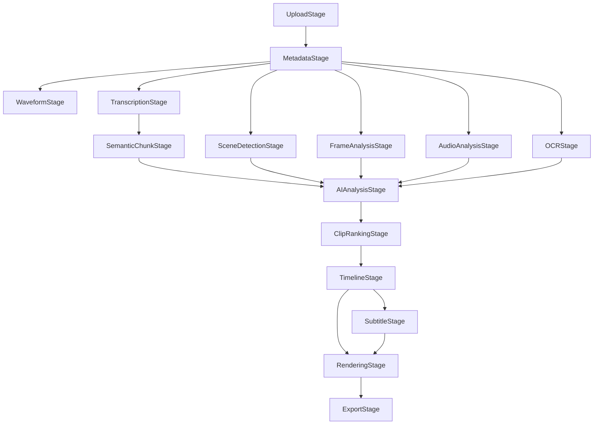

# OpenClip AI Platform - Generated System Documentation

*Generated automatically on: 2026-07-21T19:06:55.695Z*

## Active Declarative Pipeline Manifest

| Stage ID | Stage Class | Dependencies | Parallel Safe |
| :--- | :--- | :--- | :---: |
| `UploadStage` | `UploadStage` | None | No |
| `MetadataStage` | `MetadataStage` | UploadStage | No |
| `WaveformStage` | `WaveformStage` | MetadataStage | Yes |
| `SceneDetectionStage` | `SceneDetectionStage` | MetadataStage | Yes |
| `FrameAnalysisStage` | `FrameAnalysisStage` | MetadataStage | Yes |
| `OCRStage` | `OCRStage` | MetadataStage | Yes |
| `AudioAnalysisStage` | `AudioAnalysisStage` | MetadataStage | Yes |
| `TranscriptionStage` | `TranscriptionStage` | MetadataStage | Yes |
| `SemanticChunkStage` | `SemanticChunkStage` | TranscriptionStage | No |
| `AIAnalysisStage` | `AIAnalysisStage` | SemanticChunkStage, SceneDetectionStage, FrameAnalysisStage, AudioAnalysisStage, OCRStage | No |
| `ClipRankingStage` | `ClipRankingStage` | AIAnalysisStage | No |
| `TimelineStage` | `TimelineStage` | ClipRankingStage | No |
| `SubtitleStage` | `SubtitleStage` | TimelineStage | Yes |
| `RenderingStage` | `RenderingStage` | TimelineStage, SubtitleStage | No |
| `ExportStage` | `ExportStage` | RenderingStage | No |

## Execution Graph Flow

