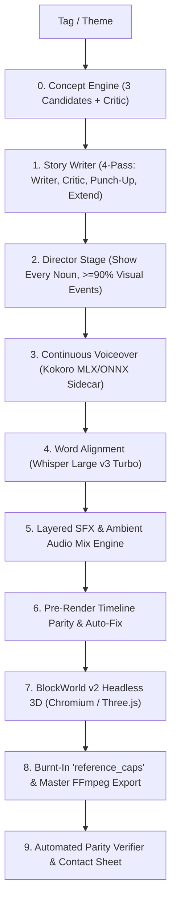

# Story Studio v2: Implementation & Engineering Plan

> **Master Specification**: Reference-grade story-time videos from one tag (9:16 vertical, Roblox-style animated, continuous voiceover, reference captions, multi-environment, deterministic 3D BlockWorld).

---

## 1. Executive Summary & Defect Remediation

The previous Story Studio implementation had significant defects compared to the reference standard:
1. **Pacing / Hard Cuts**: Only 6 cuts in 45s (1 every 7.5s) vs. reference target of ~22 cuts/min (1 every ~2.7s, max hold <= 3.0s).
2. **Dead Air**: 15 silent gaps (~12.4s, 27% dead air) with fixed ~1s pauses vs. reference continuous narration (no gaps >= 0.25s, <= 5% dead air).
3. **Environment & Cast Variety**: Single flat dark scene with 2 avatars vs. 6 distinct environments and 8+ avatars + swarms.
4. **World Rule Visualization**: Rule was narrated but not drawn within 3s.
5. **Captions**: Stale card reappearing in silent gaps; amber pill style instead of "reference_caps" (white bold rounded sans, shadow, no box, 1 word ALL CAPS).
6. **Mouth Flap**: Visually uncorrelated with audio vs. envelope-driven lip flap.
7. **Few-Shot Leakage**: Gags copied from few-shot examples without creative world building.
8. **Provider Reliability**: HTTP 410 crashes and potential silent video success reporting.

---

## 2. Architecture & Pipeline Stages

The Story Studio v2 pipeline is an immutable, content-hashed DAG orchestrated by `WorkflowEngine`:

---

## 3. Detailed Milestone Plan & Module Diffs

### Milestone 1 (M1): Robust Providers, TTS Doctor & Profiling Tools
- **Files**:
  - `backend/src/core/story/providers/GroqStoryProvider.ts`
  - `backend/src/core/story/providers/NvidiaStoryProvider.ts`
  - `backend/src/core/story/providers/ModelResolver.ts`
  - `backend/src/cli/ttsDoctor.ts`
  - `backend/src/cli/storyProfile.ts`
  - `backend/src/cli/storyParity.ts`
  - `scripts/setup-tts.sh`
- **Capabilities**:
  - GET `/v1/models` discovery with 1-token probe verification.
  - HTTP 410 permanent blacklisting with transparent fallback reporting (provider, model, status, first 300 chars of body).
  - Kokoro-82M sidecar daemon verification.
  - `npm run story:profile <video.mp4>` (extracts scene score cuts, silent gaps, LUFS, caption frequency, environments).
  - `npm run story:parity <video.mp4> [profile]` (evaluates against `roblox-storytime.json`, outputs `parity.json` and `contact-sheet.jpg`).
  - Baseline audit on previous video run.

### Milestone 2 (M2): Continuous Narration, Layered Audio & Reference Captions
- **Files**:
  - `backend/src/core/story/stages/VoiceStage.ts`
  - `backend/src/core/story/audio/AudioMixEngine.ts`
  - `backend/src/core/story/audio/SpeechSynthesisManager.ts`
  - `backend/src/core/story/captions/StoryPopCaptionEngine.ts`
  - `backend/src/core/story/audio/AudioIntegrityValidator.ts`
- **Capabilities**:
  - Sentence-level synthesis joined with micro-crossfades and inter-sentence pauses <= 0.20s.
  - Reveal pause exact calibration (<= 0.60s).
  - Speech energy guard across all narrated windows (fails job or sets `completed_with_warnings` if dead air > 5%).
  - Audio mix ducking (-12 dB) with procedural SFX on every visual event.
  - "reference_caps" preset: white bold rounded font, soft drop shadow, no background box, 2–4 words per card, 1–2 words ALL CAPS, zero stale cards, no gaps.

### Milestone 3 (M3): BlockWorld Renderer v2
- **Files**:
  - `backend/src/core/story/renderer/blockworld_scene.html`
  - `backend/src/core/story/renderer/BlockWorldRenderer.ts`
  - `backend/src/core/story/renderer/QualityGovernor.ts`
  - `assets/story/catalog.json`
- **Capabilities**:
  - Avatar procedural prints (graphic tees, plaid, hoodies, jackets with star/swirl emblems, jeans seams).
  - Hair kits (messy, curly, bun, slick, cap, fire helmet, bald).
  - Canvas facial textures (dot, shock ring, star ice, X eyes, troll grin, flat, scream, tears).
  - 5 primary 3D environments: sunny town, cafeteria, bedroom, winter storm, bright town.
  - Creatures: cat cube, mouse block, x10 huge scale, instanced swarms (300+ entities).
  - Procedural FX: white sphere puff clusters, snow particles, camera ground shake, ice encasing.
  - Cinematography: max 3.0s hold per shot, camera auto-framing keeping faces out of the 12%–20% caption band, luminance contrast checks.

### Milestone 4 (M4): Concept Engine, Story Writer & Director
- **Files**:
  - `backend/src/core/story/satire/ConceptStage.ts`
  - `backend/src/core/story/stages/ScriptStage.ts`
  - `backend/src/core/story/satire/DirectorStage.ts`
  - `backend/src/core/story/satire/WorldConceptSchema.ts`
- **Capabilities**:
  - Tag -> 3 concept candidates with critic selection.
  - Opening prefix `"In this <place>,"` + visual proof renderable in <= 3.0s.
  - 10-beat narrative structure adhering to the 1.3 time breakdown.
  - Named friend with 3 concrete quirks.
  - Few-shot leakage rejection test (4-gram overlap <= 12%).
  - Director "show every noun": visualEvent emitted for each caption card (>= 90% coverage).
  - Status tag integration (billboard plates >= 40px in >= 80% wide shots, staging monotonicity).

### Milestone 5 (M5): Time-Budget Governor & Timeline Auto-Fix
- **Files**:
  - `backend/src/core/story/renderer/QualityGovernor.ts`
  - `backend/src/core/story/satire/TimelineAutoFixer.ts`
  - `backend/src/core/story/satire/VisualQAStage.ts`
- **Capabilities**:
  - Pre-render timeline verification (cuts per minute, dead-air ratio, caption coverage, visual event coverage, environment counts).
  - Auto-fix loop (adds cutaways, trims pauses, maps assets) up to 2 iterations before rendering pixels.
  - 12-frame low-resolution sample audit (contrast, face-in-caption-band, skin-tone range).
  - Quality Governor: times first 30 frames, selects tier (draft, standard, high) fitting within `renderBudgetSec` (default 180s).

### Milestone 6 (M6): API, UI & Reference Benchmark Generation
- **Files**:
  - `backend/src/routes/v1/story.ts`
  - `frontend/src/components/story/StoryStudio.tsx`
  - `backend/src/cli/storyBenchmark.ts`
  - `docs/story-studio-report.md`
- **Capabilities**:
  - REST endpoints: `POST /api/v1/story`, `POST /api/v1/story/concepts`, `POST /api/v1/story/:id/approve-concept`.
  - Frontend UI: Concept preview card, cast table, TTS doctor status, parity checklist, contact sheet viewer.
  - 3 benchmark video runs from 3 distinct tags (60–100s) with empirical metrics and contact sheets.

---

## 4. Verification & Testing Strategy
- Jest unit and property tests covering:
  - 410 fallback and probe mechanisms.
  - Speech energy detector and zero-silent-success hard guard.
  - 4-gram leakage rejection.
  - Stale caption card regression test.
  - Staging solver monotonicity (1,000 iterations).
  - Profiler and parity tool test on fixture videos.
  - End-to-end deterministic workflow test.
